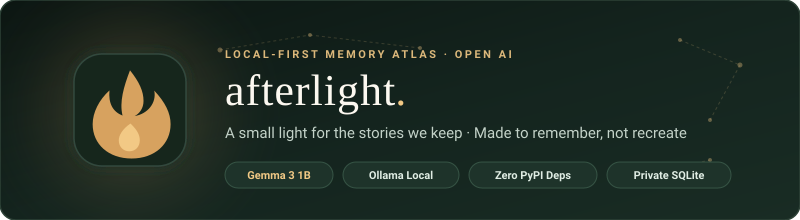
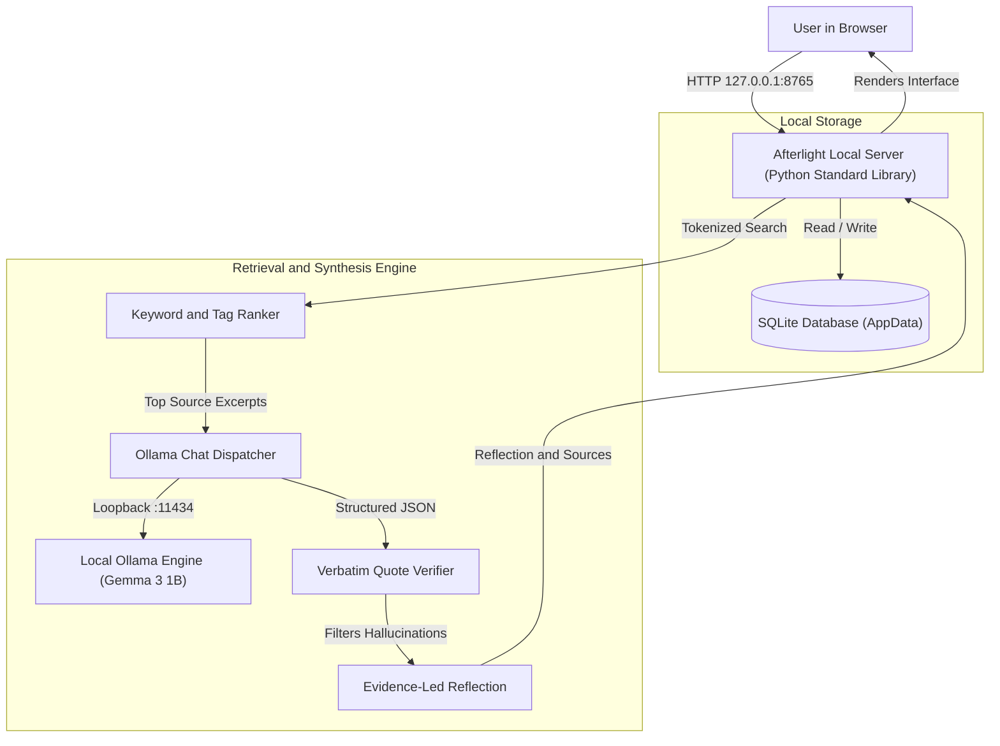
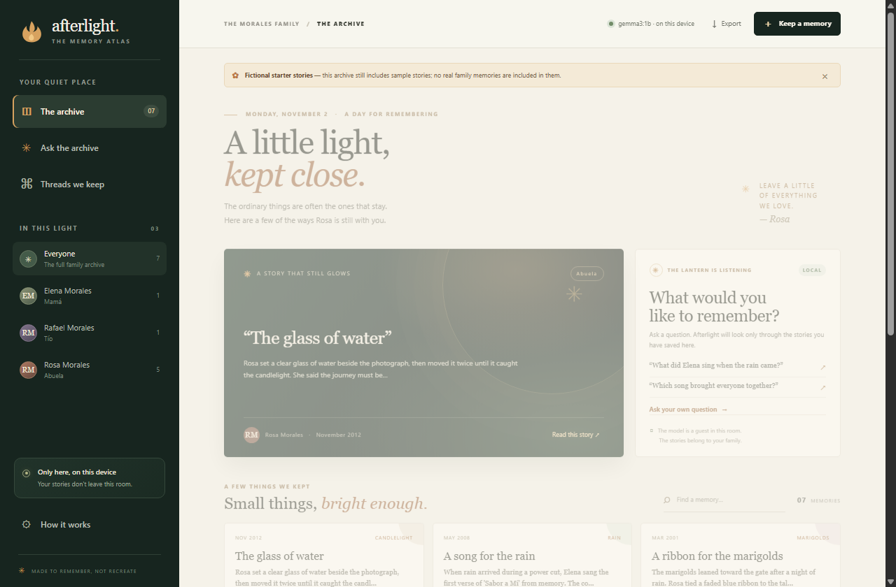
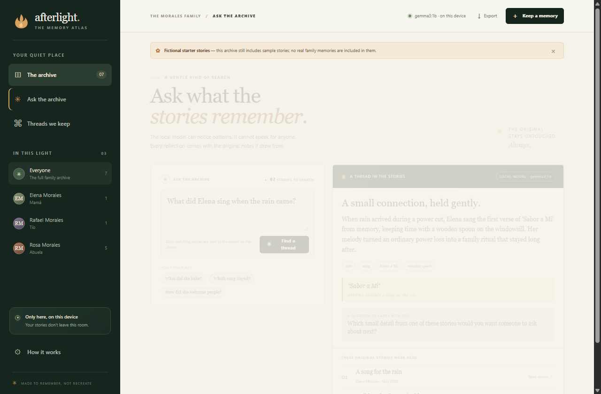
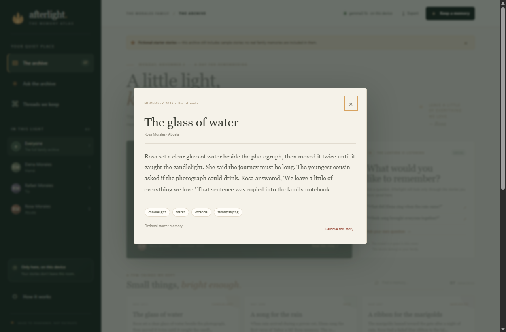
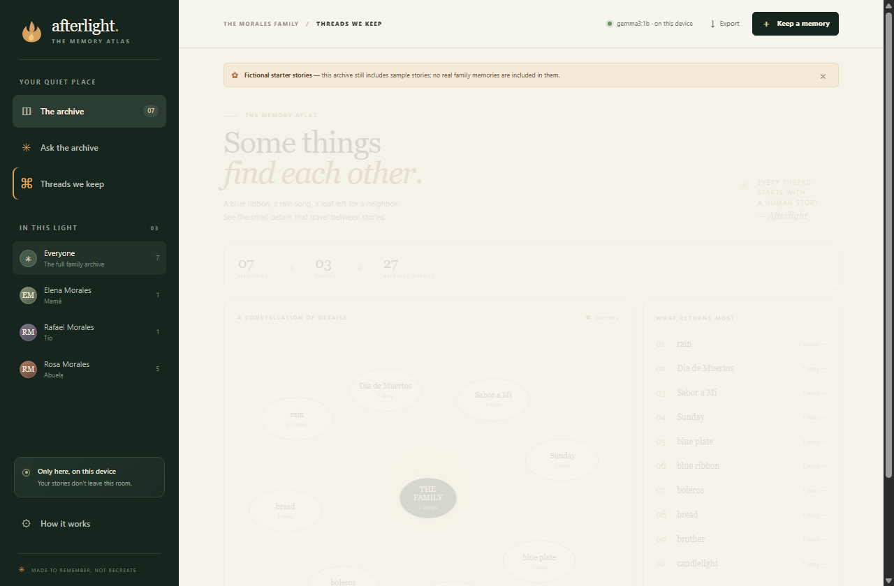
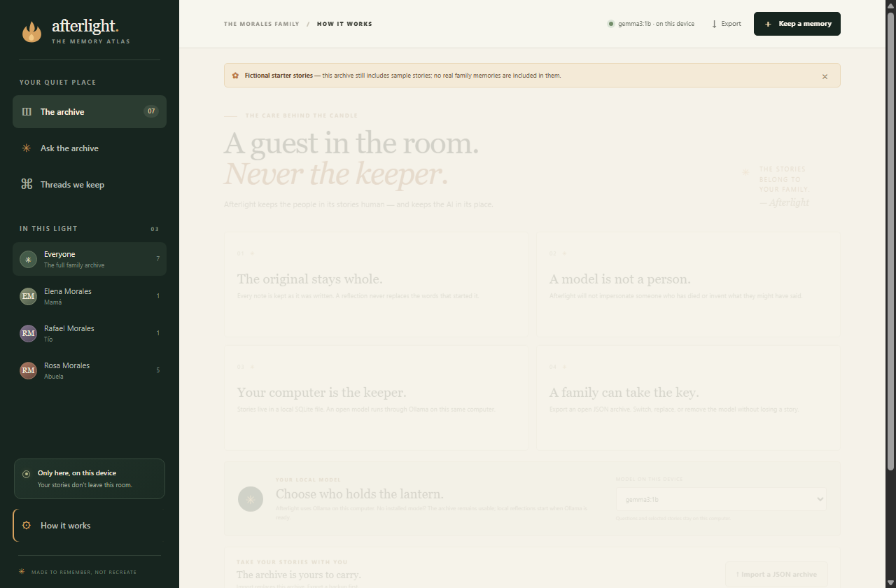

<p align="center">
  
</p>

<p align="center">
  <a href="https://www.python.org/"></a>
  <a href="requirements.txt"></a>
  <a href="https://ollama.com/"></a>
  <a href="https://huggingface.co/google/gemma-3-1b"></a>
  <a href="LICENSE"></a>
  <a href="https://dev.to/events/82"></a>
</p>

<p align="center">
  <strong>A small light for the stories we keep.</strong><br>
  <em>An evidence-led, local-first family memory archive that connects everyday moments without impersonation.</em>
</p>

---

> [!NOTE]
> *"A recipe card. A radio that needed two taps. The chair nobody puts away. Sometimes the most honest way to remember a person is to notice what they left in the room."*

**Afterlight** is a quiet, local-first memory atlas. It stores stories about a person's recipes, objects, songs, sayings, and rituals in a private local SQLite database, then uses a locally running open-weight model (**Google Gemma 3** via **Ollama**) to discover recurring threads between them.

---

## 📑 Table of Contents

- [The Philosophy](#-the-philosophy)
- [Key Features](#-key-features)
- [System Architecture](#-system-architecture)
- [Quick Start](#-quick-start)
- [Interface Tour & Walkthrough](#-interface-tour--walkthrough)
- [Configuration & Data Paths](#-configuration--data-paths)
- [Local API Reference](#-local-api-reference)
- [Security & Ethical Guardrails](#-security--ethical-guardrails)
- [License](#-license)

---

## 🕯️ The Philosophy

### *The ghost is the thread, not the impersonation.*

Family memories are sacred, intimate, and fragile. They should never be commodified into disposable cloud prompts or converted into uncanny chatbot impersonations. 

Afterlight enforces an unshakeable boundary in both its interface and prompt contracts:

1. **No Simulated Voices:** Afterlight will **never** roleplay as someone who has passed away, invent biographical dialogue, or claim to know what they would say.
2. **The Model is a Guest:** Stories belong to the family. The model's role is strictly limited to an archivist noticing recurring patterns.
3. **Verbatim Quote Verification:** Every quote returned by the model is deterministically verified against the source text. If a quote cannot be found verbatim in the original note, it is discarded before rendering.
4. **Transparent Provenance:** Model reflections are clearly badged as interpretations and always placed side-by-side with original story cards.

---

## ✨ Key Features

| Capability | Implementation | Why It Matters |
| :--- | :--- | :--- |
| **Zero-Dependency Core** | Pure Python 3 standard library (`http.server`, `sqlite3`, `urllib`) | No fragile virtual environments or supply-chain baggage. Run it anywhere. |
| **100% Local Inference** | Connects to Ollama on `127.0.0.1` (defaults to `gemma3:1b`) | Stories never traverse third-party servers or training pipelines. |
| **Offline Fallback Index** | Deterministic keyword ranking when Ollama is offline | Works seamlessly without an AI model; clearly labeled as non-AI. |
| **Quote Guardrail** | Programmatic substring verification on generated quotes | Eliminates hallucinated attributions and altered family quotes. |
| **The Memory Atlas** | Interactive SVG constellation graph (`/connections`) | Visualizes recurring motifs (e.g. *boleros*, *blue ribbon*, *marigolds*). |
| **Sovereign Storage** | Local SQLite stored in OS AppData | Shielded from accidental cloud sync (e.g. OneDrive/Dropbox folders). |
| **Open Portability** | Full JSON export and atomic archive restore (`/api/export`) | Complete data ownership with no vendor lock-in. |
| **Fictional Demo Set** | 7 preloaded stories from the Morales family | Test all capabilities immediately without risking personal privacy. |

---

## 🏛️ System Architecture

Afterlight is engineered around privacy-by-construction:



---

## 🚀 Quick Start

### 1. Prerequisites

- **Python 3.9+** (No `pip install` required; standard library only)
- **[Ollama](https://ollama.com/)** (for local open-model reflection)

### 2. Pull Gemma 3

With Ollama running, download Google's lightweight open model:

```bash
ollama pull gemma3:1b
```

> [!TIP]
> Afterlight automatically detects any model installed in Ollama. You can also use `gemma3:4b`, `gemma2:2b`, `llama3.2:3b`, or `mistral`.

### 3. Start Afterlight

#### Windows
Run the batch launcher or invoke directly:
```powershell
python main.py
```
*(Or double-click `run_afterlight.bat`)*

#### macOS / Linux
```bash
python3 main.py
```

### 4. Open the Archive

Open your browser to:
```
http://127.0.0.1:8765
```

---

## 📸 Interface Tour & Walkthrough

### 1. The Quiet Archive (`/`)
The main archive displays saved family stories, featured memories, and search with instant filtering. The status pill at the top verifies that inference runs locally on this device via loopback.

<p align="center">
  
</p>

---

### 2. Evidence-Led Reflection (`#ask`)
Ask a question about a sound, recipe, or gesture. Afterlight retrieves matching original notes, invokes Gemma 3 through loopback Ollama, displays the reflection, drops any unverified quotes, and cites source memories directly.

<p align="center">
  
</p>

---

### 3. Preserving the Original Voice
Every reflection stems from human notes. Clicking any memory opens the preserved family story, its exact date, place, and tags.

<p align="center">
  
</p>

---

### 4. The Memory Atlas (`#connections`)
Recurring objects, songs, and sayings gather into an interactive constellation map, tracing motifs across family members without AI speculation.

<p align="center">
  
</p>

---

### 5. Ethical Principles & Privacy (`#about`)
Afterlight keeps the AI in its place: local-only execution, transparent architecture, and the freedom to export or remove models at will.

<p align="center">
  
</p>

---

## ⚙️ Configuration & Data Paths

Configure Afterlight via environment variables or CLI flags:

| Setting | Default | Description |
| :--- | :--- | :--- |
| `AFTERLIGHT_PORT` | `8765` | Server port (CLI equivalent: `--port 8765`). |
| `AFTERLIGHT_DATA_DIR` | OS default | Directory holding `afterlight.sqlite3`. |
| `AFTERLIGHT_OLLAMA_URL`| `http://127.0.0.1:11434` | Ollama loopback endpoint (strictly localhost). |
| `AFTERLIGHT_MODEL` | `gemma3:1b` | Default model requested during reflection. |
| `AFTERLIGHT_EMPTY_ARCHIVE` | `0` | Set to `1` to bypass fictional demo stories on first run. |

### Default Database Locations:
- **Windows:** `%LOCALAPPDATA%\Afterlight\afterlight.sqlite3`
- **macOS / Linux:** `~/.local/share/afterlight/afterlight.sqlite3` (or `$XDG_DATA_HOME/afterlight`)

---

## 📡 Local API Reference

The HTTP server binds strictly to `127.0.0.1` and provides a clean REST-like interface:

| Method | Endpoint | Description |
| :--- | :--- | :--- |
| `GET` | `/api/status` | Reports Ollama availability, installed models, and active model. |
| `GET` | `/api/memories` | Retrieves all memories (filterable with `?person=Name`). |
| `POST` | `/api/memories` | Adds a memory record (`title`, `person`, `date`, `place`, `body`, `tags`). |
| `DELETE`| `/api/memories/<id>` | Removes a memory from the local SQLite database. |
| `POST` | `/api/ask` | Queries the archive; returns source cards, reflection, and verified quotes. |
| `GET` | `/api/summary` | Aggregates archive statistics, people counts, and motif tallies. |
| `GET` | `/api/export` | Generates a downloadable `afterlight-archive.json` snapshot. |
| `POST` | `/api/import` | Replaces the active archive with an uploaded JSON archive file. |

---

## 🛡️ Security & Ethical Guardrails

- **Strict Loopback Binding:** Only listens on `127.0.0.1`. Remote network connections are refused.
- **Strict Content Security Policy (CSP):** `default-src 'self'` prevents remote scripts, styles, tracking pixels, or CDNs from executing.
- **No Third-Party Telemetry:** Zero analytics, cookies, cloud logging, or external beacons.
- **Personal Machine Recommendation:** The SQLite database is stored unencrypted for maximum portability and standard library compatibility. Run Afterlight on a password-protected, encrypted disk (BitLocker, FileVault, or LUKS).
- **Consent First:** Always obtain consent before adding stories about living family members.

---

## 📜 License

This project is licensed under the terms of the [MIT License](LICENSE).

<div align="center">
  <sub>Built for the Hacktoberfest Open-Source AI Challenge: Week 4 — Ghost in the Machine.</sub>
</div>
